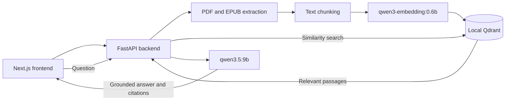

<div align="center">
  

  # Local Library AI

  **Ask your books anything. Private, grounded, and completely local.**

  [](https://nextjs.org/)
  [](https://www.python.org/)
  [](https://www.langchain.com/)
  [](https://ollama.com/)
  [](https://bun.sh/)

  <br />

  [Quick start](#quick-start) · [How it works](#how-it-works) · [Configuration](#configuration) · [API](#api-reference)
</div>

---

Local Library AI turns PDFs and ebooks into a private, searchable knowledge base. It extracts and chunks book content, creates embeddings locally, retrieves the passages most relevant to a question, and asks a local model to produce a cited answer.

> [!IMPORTANT]
> The default pipeline runs through Ollama and a local Qdrant instance. Your books, questions, embeddings, and answers stay on your machine.

## ✨ Highlights

| | Capability | What it gives you |
| --- | --- | --- |
| 📚 | Multi-format library | Upload PDF, EPUB, TXT, and Markdown files |
| 💬 | Focused chat | Ask one book, several selected books, or the whole library |
| 🔎 | Grounded retrieval | Answers are built from the most relevant passages, not guesswork alone |
| 🔖 | Source citations | Inspect the book, chapter, page, and exact supporting passage |
| 🔒 | Local by default | Ollama, embeddings, Qdrant, and generation run on your computer |
| ✍️ | Rich answers | Markdown, lists, tables, links, and code blocks render cleanly |
| 📱 | Responsive interface | Minimal chat UI for desktop and mobile |
| ♻️ | Durable indexing | Qdrant persists vectors and content hashes prevent duplicate uploads |

## 🧭 Services at a glance

| Service | Default URL | Purpose |
| --- | --- | --- |
| Web application | <http://localhost:3000> | Upload books and chat with the library |
| Backend API | <http://localhost:8000> | Ingestion, retrieval, and generation |
| API documentation | <http://localhost:8000/docs> | Interactive OpenAPI documentation |
| Qdrant dashboard | <http://localhost:6333/dashboard> | Inspect the local vector database |
| Ollama API | <http://localhost:11434> | Local embeddings and answer generation |

<a id="how-it-works"></a>

## 🧠 How it works



### Indexing a book

```text
Book upload
  → text extraction
  → overlapping chunks
  → local embeddings
  → Qdrant vectors and metadata
```

### Answering a question

```text
Question
  → question embedding
  → retrieve the eight most relevant passages
  → construct a grounded prompt
  → generate an answer
  → return the answer and source passages
```

## 🧰 Tech stack

| Layer | Technology | Role |
| --- | --- | --- |
| Interface | Next.js 16, React 19, TypeScript | Responsive library and chat experience |
| Rendering | React Markdown, remark-gfm | Rich assistant responses |
| API | Python 3.12+, FastAPI | Upload, library, health, and chat endpoints |
| RAG | LangChain | Chunking, retrieval, prompts, and model integration |
| Local AI | Ollama | Embeddings and answer generation |
| Vector store | Qdrant | Persistent similarity search and metadata filtering |
| Extraction | PyMuPDF, EbookLib, Beautiful Soup | PDF, EPUB, text, and Markdown ingestion |
| Tooling | Bun, uv, Docker Compose | Reproducible local development |

<a id="quick-start"></a>

## 🚀 Quick start

### Prerequisites

Install the following before starting:

- [Git](https://git-scm.com/downloads)
- [Docker Desktop](https://www.docker.com/products/docker-desktop/) or Docker Engine with Compose
- [Ollama](https://ollama.com/download)
- [uv](https://docs.astral.sh/uv/getting-started/installation/)
- [Bun](https://bun.sh/docs/installation)
- Python 3.12 or newer; uv can install a compatible interpreter automatically

The frontend uses Bun directly, so a separate npm installation is not required.

### 1. Clone the repository

```bash
git clone https://github.com/nagraj05/Langchain-book-chatbot.git
cd Langchain-book-chatbot
```

### 2. Download the Ollama models

Ensure the Ollama application or server is running, then pull the default models:

```bash
ollama pull qwen3.5:9b
ollama pull qwen3-embedding:0.6b
```

Approximate download sizes:

| Model | Purpose | Size |
| --- | --- | ---: |
| `qwen3.5:9b` | Answer generation | 6.6–7.6 GB |
| `qwen3-embedding:0.6b` | Document and query embeddings | 639 MB |

Verify the installation:

```bash
ollama list
```

### 3. Start Qdrant

From the repository root:

```bash
docker compose up -d qdrant
```

Check its status:

```bash
docker compose ps
```

Qdrant data is stored in the Docker volume `ebook_qdrant_data` and survives container restarts.

### 4. Configure the backend

PowerShell:

```powershell
Copy-Item backend\.env.example backend\.env
```

macOS or Linux:

```bash
cp backend/.env.example backend/.env
```

The default configuration is:

```env
OLLAMA_BASE_URL=http://localhost:11434
CHAT_MODEL=qwen3.5:9b
EMBEDDING_MODEL=qwen3-embedding:0.6b
QDRANT_URL=http://localhost:6333
QDRANT_COLLECTION=ebook_chunks
FRONTEND_ORIGIN=http://localhost:3000
```

### 5. Install and start the backend

```bash
cd backend
uv sync
uv run uvicorn app.main:app --reload --port 8000
```

Leave this terminal running. The API should now be available at <http://localhost:8000>.

### 6. Install and start the frontend

Open another terminal from the repository root:

```bash
cd frontend
bun install
bun run dev
```

Open <http://localhost:3000> in a browser.

### 7. Add a book and ask a question

1. Select **Add book**.
2. Upload a PDF, EPUB, TXT, or Markdown file.
3. Wait for indexing to finish.
4. Select one or more books in the library drawer.
5. Ask a question in the chat input.
6. Expand **source passages** beneath the answer to inspect the evidence.

The first request can be slower because Ollama must load the model into memory.

<a id="configuration"></a>

## ⚙️ Configuration

### Backend environment variables

| Variable | Default | Description |
| --- | --- | --- |
| `OLLAMA_BASE_URL` | `http://localhost:11434` | Ollama HTTP API |
| `CHAT_MODEL` | `qwen3.5:9b` | Model used to generate answers |
| `EMBEDDING_MODEL` | `qwen3-embedding:0.6b` | Model used to embed passages and queries |
| `QDRANT_URL` | `http://localhost:6333` | Qdrant HTTP API |
| `QDRANT_COLLECTION` | `ebook_chunks` | Vector collection name |
| `FRONTEND_ORIGIN` | `http://localhost:3000` | Allowed browser origin for CORS |

### Frontend environment variables

The default backend URL is `http://localhost:8000`. To use another address, create `frontend/.env.local`:

```env
NEXT_PUBLIC_API_BASE_URL=http://localhost:8000
```

Restart the frontend after changing environment variables.

<a id="api-reference"></a>

## 🔌 API reference

| Method | Endpoint | Description |
| --- | --- | --- |
| `GET` | `/api/health` | Check Ollama and Qdrant connectivity |
| `GET` | `/api/books` | List indexed books |
| `POST` | `/api/books/upload` | Upload and index a book |
| `DELETE` | `/api/books/{book_id}` | Delete a book and its vectors |
| `POST` | `/api/chat` | Retrieve relevant passages and generate an answer |

Example chat request:

```bash
curl http://localhost:8000/api/chat \
  -H "Content-Type: application/json" \
  -d '{
    "question": "What motivates the main character?",
    "book_ids": [],
    "history": []
  }'
```

An empty `book_ids` array searches every indexed book.

## 🗂️ Project structure

```text
.
├── backend
│   ├── app
│   │   ├── config.py       # Environment configuration
│   │   ├── ingestion.py    # File extraction and chunking
│   │   ├── library.py      # Local book registry
│   │   ├── main.py         # FastAPI endpoints
│   │   ├── rag.py          # Embedding, retrieval, and generation
│   │   └── schemas.py      # API request and response models
│   ├── tests
│   ├── pyproject.toml
│   └── uv.lock
├── frontend
│   ├── app
│   │   ├── globals.css
│   │   ├── layout.tsx
│   │   └── page.tsx
│   ├── package.json
│   └── bun.lock
├── docker-compose.yml
└── README.md
```

Runtime data is deliberately excluded from Git:

- `backend/data/library.json` contains the local book registry.
- Qdrant vectors are stored in the Docker volume.
- Uploaded files are processed in memory or temporary storage and are not committed.

## 🛠️ Development

### Backend checks

```bash
cd backend
uv run ruff check .
uv run pytest -q
```

### Frontend production build

```bash
cd frontend
bun run build
```

### Stop local services

Stop Qdrant without deleting its data:

```bash
docker compose stop qdrant
```

Start it again later:

```bash
docker compose up -d qdrant
```

## ☁️ OpenAI and Claude options

Yes, but the current repository is configured for Ollama only. The retrieval pipeline is provider-independent, so the answer-generation component in `backend/app/rag.py` can be replaced with another LangChain chat model.

### OpenAI API

Use the OpenAI API rather than trying to connect directly to the Codex desktop application. For ordinary RAG question answering, an OpenAI text model accessed through the Responses API or LangChain's `ChatOpenAI` integration is the appropriate interface.

A future provider implementation would require:

```bash
cd backend
uv add langchain-openai
```

and a server-side environment variable:

```env
OPENAI_API_KEY=your-key
```

Never place API keys in `frontend/.env.local` or commit them to Git.

Codex has an SDK and app-server for building agentic coding workflows, but it is a different integration layer and is not a drop-in chat-model backend for this book RAG application. See the [OpenAI API quickstart](https://developers.openai.com/api/docs/quickstart) and [Codex platform overview](https://developers.openai.com/blog/codex-as-a-platform).

### Claude API

Claude can be used through Anthropic's Messages API or LangChain's `ChatAnthropic` integration.

A future provider implementation would require:

```bash
cd backend
uv add langchain-anthropic
```

and a server-side environment variable:

```env
ANTHROPIC_API_KEY=your-key
```

See the [Claude API overview](https://platform.claude.com/docs/en/api/overview).

### Recommended hybrid deployment

Embeddings and Qdrant can remain local while only answer generation uses OpenAI or Claude:

```text
Local books
  → local extraction
  → local embeddings
  → local Qdrant retrieval
  → selected passages sent to the cloud model
  → answer returned to the browser
```

This is faster on computers without a capable GPU, but the question and retrieved passages leave the computer. Users must understand that privacy tradeoff and the provider's pricing and data-handling policies.

Provider selection is not yet implemented in the UI. A clean next step is to add a backend provider factory controlled by environment variables such as `LLM_PROVIDER`, `CHAT_MODEL`, and provider-specific API keys.

## 🔐 Privacy and security

With the default configuration:

- Book extraction happens locally.
- Embeddings are generated locally.
- Vectors are stored in local Qdrant.
- Answers are generated locally through Ollama.
- No LangSmith tracing is enabled.

If you add a hosted provider, retrieved book passages and user questions will be transmitted to that provider. Keep all credentials on the backend and out of version control.

## 🩺 Troubleshooting

### `Services offline` appears in the interface

Check all three services:

```bash
ollama list
docker compose ps
curl http://localhost:8000/api/health
```

### Ollama connection fails

Ensure Ollama is running and confirm its API:

```bash
curl http://localhost:11434/api/tags
```

If Ollama is running on another machine, update `OLLAMA_BASE_URL`.

### Qdrant connection fails

Start or recreate the container:

```bash
docker compose up -d qdrant
docker compose logs qdrant
```

### Answers are slow

The default 9B model is slow when it runs entirely on CPU. Options include:

- Use a smaller local model, such as `qwen3.5:4b`.
- Use a supported GPU with Ollama.
- Route answer generation to a hosted model provider.
- Keep the local embedding model and Qdrant even when using cloud generation.

### A scanned PDF produces no text

The current PDF pipeline extracts embedded text and does not perform OCR. Run OCR on scanned documents before uploading them.

### Browser requests are blocked by CORS

Set `FRONTEND_ORIGIN` to the exact frontend URL, including its port, and restart the backend.

## 🚧 Current limitations

- Chat history is stored only in browser memory and disappears on refresh.
- Scanned PDFs require OCR before upload.
- Retrieval uses dense vector similarity without BM25 hybrid search or reranking.
- Provider selection is not yet available in the interface.
- CPU-only generation can be slow.
- LangGraph is not required by the current linear RAG pipeline and is not yet used.

## 🗺️ Roadmap

- OpenAI and Claude provider factory
- Streaming token responses
- Hybrid dense and keyword retrieval
- Passage reranking
- Persistent conversation history
- OCR for scanned PDFs
- Background ingestion progress
- Automated RAG evaluation
- Optional LangGraph retrieval correction

## 🤝 Contributing

Issues and pull requests are welcome. Before submitting a change, run the backend checks and frontend production build documented above.

---

<div align="center">
  <strong>Your library. Your machine. Your answers.</strong>
  <br />
  <sub>Built for private, grounded conversations with the books that matter to you.</sub>
</div>

